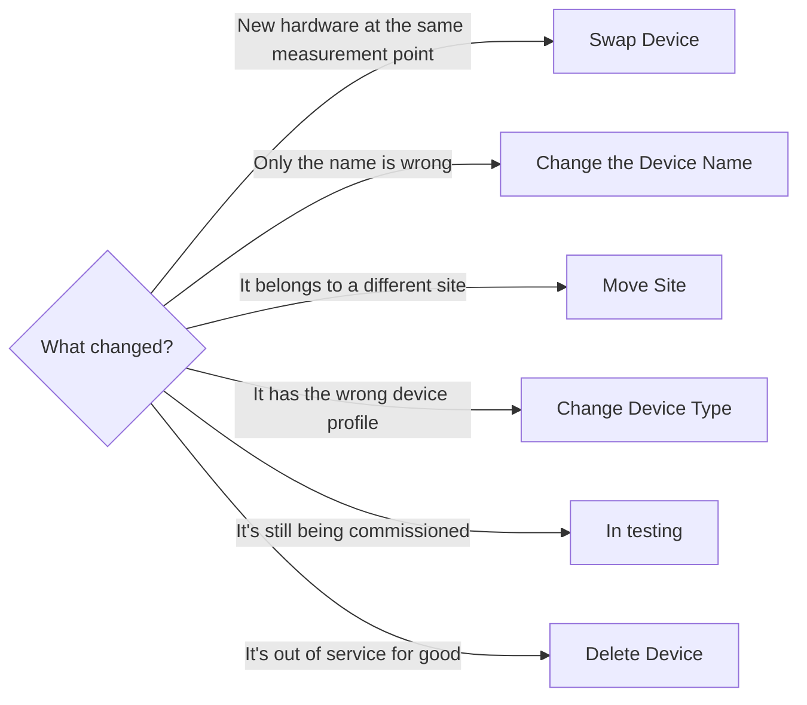

After a device is added, changes to it go through a handful of actions on its edit page. This page shows which one fits the situation, what each one changes, and what happens in order when you run it.

To find them, open the device's page and choose **Edit**. **Device Name** is under Editable fields. **Move Site**, **Swap Device**, **Change Device Type** and **In testing** are under Device actions, and **Delete Device** is under Danger Zone. In testing appears only on systems with commissioning turned on.

## Which action to use

## What each action changes

| Action | The device in SiteSync | Tags | Network server | Downlink history |
| --- | --- | --- | --- | --- |
| Swap Device | The new sensor takes the old one's name, description, metadata, install location and photo. The old sensor is archived. | The new sensor writes to the old sensor's tag path, so trends, history and alarms carry on. | The new sensor is registered if you added it during the swap. The old sensor's registration is left as it is. | The old sensor's downlinks are kept and listed on the new sensor, ready to resend. |
| Change the Device Name | The name changes. | The tag keeps its name. To rename the tag as well, use Tag Management. | Not changed. | Stays with the device. |
| Move Site | The device belongs to the new site. | Stay at the same tag path. | Not changed. | Stays with the device. |
| Change Device Type | The device uses the new device profile. | The tag switches to the new profile's tag type and keeps its values, history and alarm settings. | Not changed. | Stays with the device. |
| In testing | The device is marked In testing and left out of dashboards and counts. | Keep updating as normal. | Not changed. | Stays with the device. |
| Delete Device | The device is removed. | The device's tags are deleted. | The device is removed from the network server. | Kept. Downlink history is never removed. |

## What happens when you run each one

### Swap Device

1. If the new sensor isn't in SiteSync yet, it's added and registered on the network server.
2. The new sensor takes over the old sensor's tag path.
3. The old sensor's name, description, metadata, install location and photo are copied to the new sensor.
4. The old sensor is archived and the replacement is recorded, with the reason and who did it.
5. The audit log gets **Device replaced** on the old sensor and **Device swapped in** on the new one.

The full walkthrough is on [Swap a device](/use/device-swap/).

### Change the Device Name

1. Enter the new name in **Device Name** and choose **Save**.
2. The name changes everywhere SiteSync shows the device.
3. The audit log gets **Device renamed**.

The tag isn't renamed by this. See [Move and rename tags](/use/move-rename-tags/).

### Move Site

1. Choose the new site.
2. The device moves to that site in SiteSync, and it's listed and counted there from then on.
3. The audit log gets **Device moved to another site**, with the old and new site.

### Change Device Type

1. Choose the new device profile.
2. The device is saved with that profile, so its next uplinks are decoded with the new profile's decoder.
3. The device's tag is pointed at the new profile's tag type. Values, history and alarm settings on the tag are kept.
4. The audit log gets **Device type changed**.

### In testing

1. Turn **In testing** on.
2. The device keeps reporting, but it's left out of dashboards and counts.
3. Turn it off when the device goes live.

### Delete Device

1. The device is removed from the network server.
2. The device is removed from SiteSync.
3. The device's tags are deleted.
4. The audit log gets **Device deleted**.

Downlinks that were sent to the device stay in the downlink history.

## Related pages

- [Swap a device](/use/device-swap/)
- [Downlink history](/use/downlink-history/)
- [Move and rename tags](/use/move-rename-tags/)
- [Audit logging](/configure/audit-logging/overview/)
