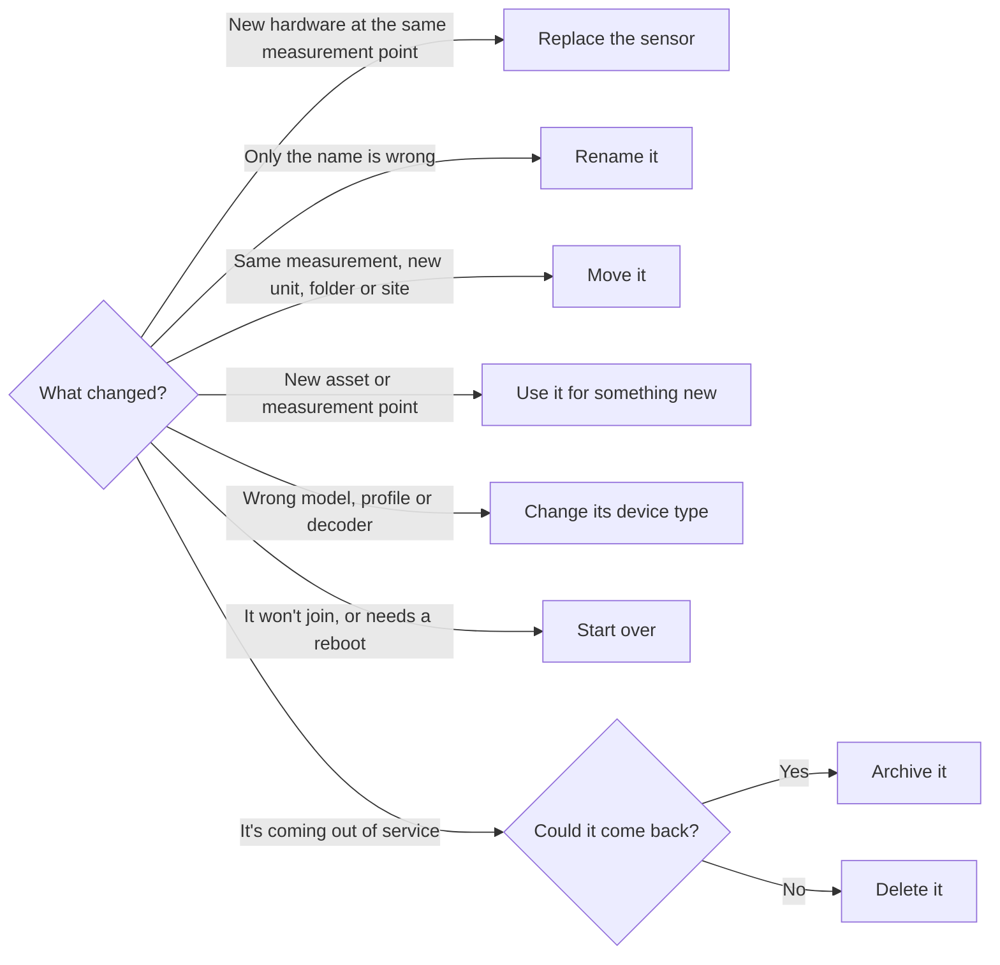

Every change to a device after it's added goes through one of eight actions. This page shows which one fits the situation and what each one does to the device's tags, history, network server registration and PI points.

To open them, go to the device's page, choose **Edit**, then choose **Device actions**. A panel opens on the right with a tile for each action. Start over, Archive it and Delete it sit under **Danger zone**.

Device actions is an optional feature. If the edit page shows separate **Swap Device**, **Rename**, **Move Site**, **Change Type** and **Delete** buttons instead, it isn't turned on for your system.

## Which action to use

## What each action does

The ThingPark and PI columns apply when SiteSync is connected to them.

| Action | SiteSync | ThingPark | PI |
| --- | --- | --- | --- |
| Replace the sensor | The new sensor takes over the name, tags, photos and history. The old sensor moves to Archived. | The new sensor is added to the site's domain. The old sensor is removed. | Nothing changes. Same points, and history carries on. |
| Rename it | Tags are renamed. Their history follows. | Renamed. Same domain. | Same points, renamed to match. History stays with them. |
| Move it | Tags move to the new site, unit or folder. Their history follows. | Moves to the new site's domain. Stays where it is if the site doesn't change. | Same points, history kept. The site part of their names changes if the site does. |
| Use it for something new | New name and a new installation record. The old history stays under the old name. | Renamed, and moved to the new site's domain if the site changes. Stays joined. | New points under the new name. The old points are kept as history. |
| Change its device type | New profile. Tags are rebuilt under the same name. | Device profile updated. The sensor joins again. | Readings that match keep their points. You choose what happens to the others. |
| Start over | Removed and added back with the same name. Photos and installation record kept. | Removed and created again, so the sensor joins fresh. | Same points. Values resume once it rejoins. |
| Archive it | Hidden from lists. Tags and history kept. It can be restored. | Stays in ThingPark and keeps its join. | Sending stops. Points and history kept. |
| Delete it | The device, its tags and its installation record are deleted. The name is free to use again. | Removed from ThingPark. | Nothing more is sent. The points and their history stay in PI. |

Each action shows this same summary for the device you're working on before anything runs, and reports the result for each system when it finishes.

## Choices that change the result

Some actions ask a question, and the answer changes one of the cells above.

| Action | Choice | If you change it |
| --- | --- | --- |
| Replace the sensor | Remove the old sensor from ThingPark (ticked) | Unticked, the old sensor stays joined so it can be reused as a spare. |
| Rename it | Rename the PI points (yes) | With no, the points keep their old names and the device notes that the names differ. |
| Move it | Keep the same PI points (yes) | With no, new points start at the new location. The old points stay in PI and stop updating. |
| Archive it | Remove it from ThingPark (unticked) | Ticked, it's removed from ThingPark as well. |
| Delete it | Remove it from ThingPark (ticked) | Unticked, it stays joined, for example to add it back later without new keys. |

## Related pages

- [Swap a device](/use/device-swap/)
- [Downlink history](/use/downlink-history/)
- [Move and rename tags](/use/move-rename-tags/)
